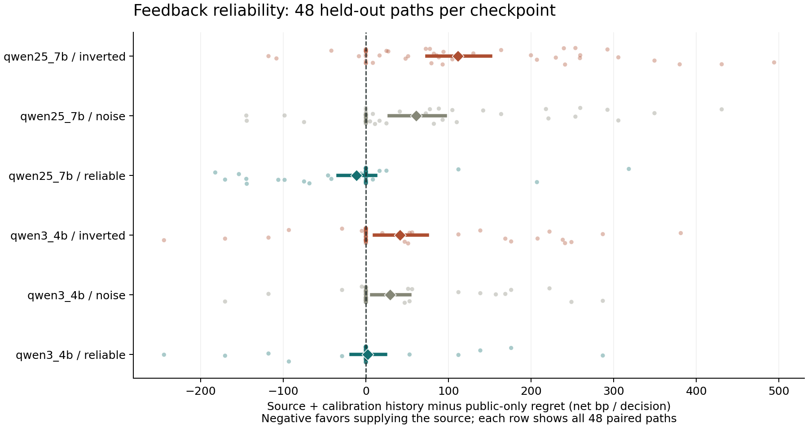

# Can local language models assess feedback reliability?

A preliminary, paired synthetic evaluation. All values below are mean expected-value regret in net basis points per decision; lower is better. These are not trading profits.

48 independent paths per checkpoint; eight settled calibration episodes then one fresh decision per path; four paired conditions. Confidence intervals are descriptive paired-path bootstrap intervals, not multiplicity-adjusted significance tests.

| Checkpoint | Public only | Reliable source | Noise source | Inverted source |
| --- | ---: | ---: | ---: | ---: |
| qwen3_4b | 41.42 | 43.74 | 70.49 | 82.85 |
| qwen25_7b | 35.73 | 24.11 | 96.34 | 146.88 |

## Reviewed conclusion

In this fixed direct-choice setup, **noisy and inverted source packages worsened mean decision quality in both checkpoints**. Reliable-source contrasts were uncertain: Qwen3 +2.32 bp (descriptive 95% interval -18.01 to +23.70), Qwen2.5 -11.62 bp (-33.75 to +11.71), relative to each model's public-only choices. Neither reliable-source interval establishes the planned 25-bp improvement scale. No equivalence or multiplicity-adjusted significance claim is made.

The stronger result is a failure of robustness, not a demonstrated internal trust mechanism. Qwen3 chose asset B on **47/48 inverted-source questions** (and cash on 0/48), compared with asset B on 25/48 public-only questions. It also never chose cash in either other source condition. Raw/scored choices match; all prompts fit the 4,096-token context (maximum 775). This behavior was not hidden behind aggregate means.

A separately frozen, fresh post-hoc diagnostic found **both checkpoints changed their physical decision on 2/4 inverted-source paths when arbitrary asset names were exchanged**, while remaining physically consistent on all 4/4 public-only paths. The numerical information and its sequence were preserved. With only four independent diagnostic paths, this exposes examples of naming/presentation sensitivity; it does not establish its population rate or isolate names, output-schema order, or internal reasoning. The original 48-path primary results are unchanged and this follow-up is not pooled with them.

## Source package minus the same model without it

Negative differences favor supplying the source and its calibration history. Each interval resamples whole paired paths.

| Checkpoint | Source | Difference (bp) | Descriptive 95% interval | Better / tied / worse paths |
| --- | --- | ---: | --- | --- |
| qwen3_4b | reliable | +2.32 | [-18.01, +23.70] | 5 / 38 / 5 |
| qwen3_4b | noise | +29.07 | [+6.96, +53.22] | 4 / 32 / 12 |
| qwen3_4b | inverted | +41.43 | [+10.37, +74.34] | 6 / 26 / 16 |
| qwen25_7b | reliable | -11.62 | [-33.75, +11.71] | 13 / 29 / 6 |
| qwen25_7b | noise | +60.61 | [+28.07, +96.33] | 4 / 21 / 23 |
| qwen25_7b | inverted | +111.15 | [+73.60, +150.76] | 4 / 11 / 33 |

## Statistical comparison

| Checkpoint | Source | LLM regret | Calibrated rule regret | Difference (bp) | Descriptive 95% interval |
| --- | --- | ---: | ---: | ---: | --- |
| qwen3_4b | reliable | 43.74 | 7.57 | +36.17 | [+15.26, +59.91] |
| qwen3_4b | noise | 70.49 | 27.64 | +42.85 | [+16.60, +70.79] |
| qwen3_4b | inverted | 82.85 | 16.08 | +66.77 | [+36.53, +98.52] |
| qwen25_7b | reliable | 24.11 | 7.57 | +16.55 | [+2.02, +35.01] |
| qwen25_7b | noise | 96.34 | 27.64 | +68.70 | [+35.52, +105.19] |
| qwen25_7b | inverted | 146.88 | 16.08 | +130.79 | [+94.78, +167.87] |

## Integrity and interpretation

428 logged local requests in the successful v2 controls, development and evaluation. An additional 7 prior-interface attempts and 2 adapter failures and six excluded-candidate controls are retained separately (443 total attempts). All included-checkpoint gates and independent raw-response audits passed. No paid model calls; host compute and storage excluded. Full accounting and per-path values are in the accompanying JSON.

The simple calibrated rule estimates a signed relationship from the same noisy settled outcomes shown to the models. It never receives the source label or latent scoring truth. It is a specialized fixed estimator: its 100-bp residual standard-deviation floor matches the simulator settlement-noise scale, which is not stated in the model prompt. Thus it shares the observed records but has different structural assumptions; a gap against it alone does not establish superiority under identical total prior knowledge. This affects the secondary benchmark interpretation, not the primary within-model paired source contrasts. Agreement with that rule is behavioral evidence, not proof of an internal reasoning process.

The source-versus-public comparison adds both current forecasts and their calibration history. It cannot isolate the causal benefit of history, wording length or attention. Inverted advice is a stationary negative relationship that can be corrected, not a malicious adaptive adversary. Reliable and inverted forecasts have equal information content for an observer that knows the sign; only the noise condition removes predictive information. Current source numbers differ across arms; identical-current-advice history ablations would require a separate protocol.

Phi-3.5-mini, the different-family candidate, produced valid JSON but failed the frozen numeric gate (4/6; both cash-winning cases wrong) and was excluded without development or evaluation. Consequently, the completed comparison remains two Qwen-family checkpoints. Only fixed quantized checkpoints, a single prompt and a stationary Gaussian testbed were examined. The 48 paths improve coverage over the previous 24-path study but do not guarantee precision. No general financial forecasting, model-family superiority, learning, or publication-novelty claim follows.

The earlier factorial study separated source information from wording. This study fixes wording across source arms and replaces privileged past expected-return feedback with noisy settled calibration outcomes. It evaluates source-use robustness rather than establishing outcome bias or introducing a new agent algorithm.

## Separate post-hoc label diagnostic

Protocol: FEEDBACK_LABEL_DIAGNOSTIC_PROTOCOL.md. New seeds 62300-62303; public-only/inverted conditions x original/renamed inputs x two checkpoints. All 32 responses were structurally valid. No prompt retuning or original-question replay occurred. Literal names and associated input keys/menu identifiers were swapped while the same physical numbers and their sequence were retained; choices were mapped back to physical assets.

| Checkpoint | Condition | Same physical choice / 4 | Original asset B / 4 | Renamed asset B / 4 |
| --- | --- | ---: | ---: | ---: |
| qwen25_7b | inverted | 2 | 2 | 1 |
| qwen25_7b | public_only | 4 | 1 | 3 |
| qwen3_4b | inverted | 2 | 3 | 3 |
| qwen3_4b | public_only | 4 | 1 | 3 |

The main study accounts for 443 attempted requests. The separate post-hoc diagnostic adds 32, for **475 combined attempts**, including 474 recorded model responses and one request failure without reported token usage. A prior long-rationale response and a truncated Phi adapter response remain invalid and are not repaired or pooled into primary performance. The different-family Phi candidate was excluded after 4/6 certain-value controls; this concerns the tested checkpoint/runtime/prompt combination, not all Phi models.

Expected-value regret uses a perfect-information simulator reference. Positive regret can occur for a rational decision maker with noisy observations, so it does not itself prove irrationality. The forecasts here are simulator-generated noisy measurements, not predictions from a trained financial model. The primary intervention changes both current forecasts and calibration history, and the numerical benchmark has specialized structural assumptions. The evidence supports a controlled evaluation artifact and examples of pipeline fragility, not profitable trading, a new learning algorithm, or a verified literature-first finding. See the separate prior-work comparison for the bounded literature review.
