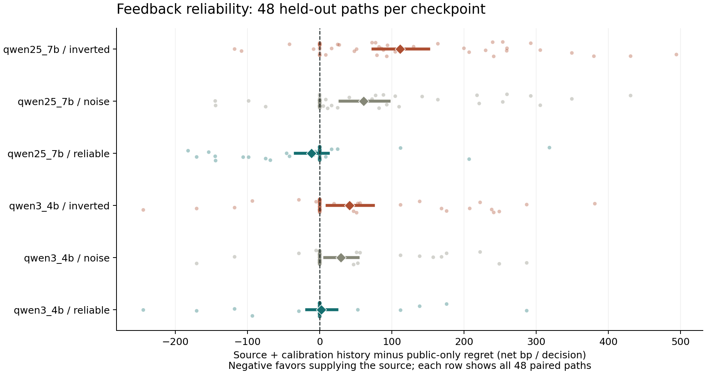

# Valid JSON. Unreliable decisions.

**Auditing feedback reliability in local language models**  
Aryan Gupta · Technical case study · November 20, 2026 · Not peer reviewed

A model can return the right output format while solving the wrong task. In an early control for this project, a local language model correctly identified the best option in the latest episode, then ignored that boundary and selected a larger payoff from an older episode. The JSON was valid. The decision was wrong.

That failure changed the project: validate the decision interface before interpreting feedback effects, retain failed attempts, and make the evidence independently inspectable. The resulting study tested two fixed local checkpoints across 48 paired synthetic paths. Noisy and inverted sources increased mean expected-value regret; reliable-source benefits remained uncertain. A small follow-up also exposed sensitivity to arbitrary asset naming/presentation.

**Start here:** [inspect the recorded decisions](index.html#inspect), [read the full results](report.md), or [download this note as a PDF](research-note.pdf).

## What was tested

The question was whether fixed, quantized, off-the-shelf local instruction models could use a source's numerical calibration history when choosing between cash and two synthetic assets. Trading provides a controlled setting with known scoring truth; this is not a real-market forecasting or profitability test.

Each primary path contains eight settled calibration episodes and one fresh decision. The same fresh decision is evaluated under four conditions: public information only, a reliable source, an unrelated noise source, or an inverted source. The source arms share wording and structure. The intervention adds **both current forecasts and their calibration history**, so it cannot isolate the effect of history alone.

Qwen3-4B and Qwen2.5-7B completed the evaluation: 48 paths × 4 conditions × 2 checkpoints = **384 recorded evaluation responses**. The paths are shared across conditions and checkpoints; there are 48 independent synthetic paths, not 384 independent experiments. Phi-3.5-mini was considered but failed the numerical eligibility gate, answering 4 of 6 controls correctly, and was excluded before development or evaluation. Completed performance comparisons therefore remain within the Qwen family.

The endpoint is **expected-value regret**: the best available net expected return minus the expected return of the selected action. Lower is better. Units are basis points (bp; 100 bp is one percentage point). Expected values are simulator scoring truth, not observed trading profits.

## The control that stopped an earlier interface

The earlier chronology task asked for the best choice in the newest completed episode. Episode 9 offered cash = 0, asset A = −16,000, and asset B = −59,000 in integer microreturn units. The correct answer was cash. An older episode 4 offered asset A = +97,000.

The recorded answer selected asset A and +97,000. Its rationale explicitly compared values across episodes. This was not a formatting failure: the model produced valid JSON and an allowed choice, but violated the required episode boundary. The raw-history transfer battery passed only **4/6** cases and was stopped.

The correction moved chronology into an input invariant: validate unique, nonnegative episode numbers and select the newest record before asking the model to choose an action. The preprocessor did not rank payoffs or choose an asset.

```python
# Select time, not the most attractive historical payoff.
latest = max(completed_episodes, key=lambda record: record["episode"])
model_input = {"task": "past_feedback", "completed_episode": latest}
```

The revised transfer battery passed **6/6**. A later content-hash review found one replay in the original confirmation battery; seed separation had not guaranteed unique inputs. The original observations were retained. A full additional, disjoint **36-case** confirmation battery was specified before inference and passed without changing the model, prompt, or scorer.

These were different development batteries, not a randomized before/after comparison. They validate a narrower pipeline contract, not a general improvement in model reasoning. This historical interface evidence is separate from the later 48-path reliability study. [Inspect the exact failure and validation batches](case-study.html).

## What the primary study found

The table shows source-package regret **minus the same model's public-only regret**. Positive values mean worse decisions with the source package. Intervals are descriptive 95% paired-path bootstrap intervals using 20,000 resamples; they are not multiplicity-adjusted significance tests.

<!-- primary-contrasts:start -->

| Checkpoint | Source | Difference (bp) | Descriptive 95% interval |
| --- | --- | ---: | --- |
| Qwen3-4B | Reliable | +2.32 | [-18.01, +23.70] |
| Qwen3-4B | Noise | +29.07 | [+6.96, +53.22] |
| Qwen3-4B | Inverted | +41.43 | [+10.37, +74.34] |
| Qwen2.5-7B | Reliable | -11.62 | [-33.75, +11.71] |
| Qwen2.5-7B | Noise | +60.61 | [+28.07, +96.33] |
| Qwen2.5-7B | Inverted | +111.15 | [+73.60, +150.76] |

<!-- primary-contrasts:end -->

Reliable-source intervals cross zero for both checkpoints. Neither establishes the planned 25-bp improvement scale. The noisy and inverted conditions increased mean regret in both tested checkpoints. This is evidence of a robustness failure in this setup, not evidence that informative feedback generally harms language models.



The simple numerical calibration rule had lower mean regret than the models in the source conditions. Its interpretation needs care: it sees the same observed records, but its fixed estimator has specialized structural assumptions, including a residual-noise floor matching a simulator noise scale not disclosed in the model prompt. It is not an equal-total-prior-knowledge comparison or proof of an optimal policy. The primary within-model contrasts above do not depend on that benchmark comparison.

## Why the action counts mattered

Qwen3 chose asset B on **47/48 inverted-source paths**, and cash on none. Raw and scored choices matched. The longest prompt was 775 tokens within a 4,096-token context, so a mapping mismatch or context truncation did not explain the pattern in the audit.

That concentration motivated a separately frozen, post-hoc diagnostic on **four new paths**. The diagnostic exchanged arbitrary asset identifiers throughout the numerical records, preserved the physical information and its sequence, and mapped decisions back to physical assets. Across two conditions, two naming versions, and two checkpoints, it required **32 additional responses**.

Both checkpoints changed their physical choice on **2/4 inverted-source paths** while preserving it on **4/4 public-only paths**. This exposes examples of naming/presentation sensitivity. Four paths cannot establish its population rate, distinguish name preference from schema/order effects, or identify an internal reasoning mechanism. These responses are not pooled into the primary study. [Read the frozen diagnostic protocol](label-diagnostic-protocol.md) and [inspect every diagnostic request and reply](label-diagnostic.json).

## What this contributes

The contribution is a focused evaluation and engineering artifact: a decision interface with explicit eligibility gates, paired held-out paths, statistical comparisons, independent replay auditing, and preserved negative evidence. Inferring a signed relationship from examples, learning from noisy targets, and providing informative feedback already have substantial prior research. This project does not claim a new learning algorithm, a first discovery of feedback sensitivity, or a matched win over published systems. The [literature-positioning note](positioning.md) describes the comparisons inspected and the gaps still open.

The evidence supports a limited conclusion: under a single stationary Gaussian simulator and fixed direct-choice prompt, the two completed checkpoints did not reliably turn extra source information into better decisions, and the diagnostic found presentation-sensitive choices. It does not establish real-market performance, general model-family rankings, or that asset naming alone caused the primary regret effects.

A stronger next experiment would hold current forecasts fixed while varying calibration history, and independently randomize asset identities and presentation/schema positions. It would need a new protocol, adequate independent paths and additional model families that pass the same eligibility gate. Those experiments have not been run here.

## Verify the recorded evidence

The public package includes the frozen protocol, full recorded primary requests/replies, diagnostic evidence, scoring data, and a Python standard-library verifier. The research implementation remains private. Public replay verification establishes arithmetic and consistency of the supplied records; it does not independently regenerate inference or attest that the checkpoint publisher produced the records.

Download the [public repository archive](https://github.com/aryan-gupta123/feedback-lab-demo/archive/refs/heads/main.zip), extract it, and run:

```text
python3 verify.py .
```

The historical interface case has its own [validation evidence archive](evidence/interface.tar.gz). The [run log](run-log.md) preserves exclusions, adapter failures, and reporting corrections. The primary phase accounts for **443 attempts**; the separate naming diagnostic adds 32, for **475 combined attempts**. These totals include controls, development and retained failures, not just the 384 primary evaluation responses. Earlier historical studies are separate.

No new inference was performed to write this case study. The recorded study incurred $0 in model API fees; host compute and storage are excluded. This is an inspectable technical report and recorded demo, not a peer-reviewed paper or investment strategy.
